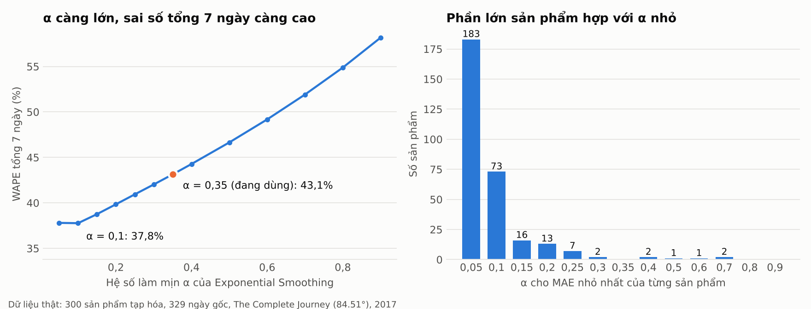

# Kiểm chứng mô hình dự báo trên dữ liệu bán hàng thật

> Dữ liệu: **The Complete Journey** của 84.51° (qua gói R `completejourney`, giấy phép CC0): giao dịch mua hàng tạp hóa thật của 2.469 hộ gia đình tại một chuỗi siêu thị Mỹ, từ 01/01/2017 đến 31/12/2017. Đây **không phải** dữ liệu của cửa hàng Việt Nam và chỉ là mẫu theo hộ gia đình (không phải toàn bộ doanh số cửa hàng), nên dùng để kiểm chứng **phương pháp**, không dùng để khẳng định con số cho một cửa hàng cụ thể.

Phạm vi: 300 sản phẩm bán đều nhất, 329 ngày gốc dự báo, mỗi lần dùng 30 ngày lịch sử để dự báo 7 ngày kế tiếp, tổng cộng 690.900 điểm so sánh.

## 1. Kết quả chính

- **Mô hình đang chạy (Exponential Smoothing α = 0,35)**: mỗi ngày lệch trung bình 2,74 đơn vị/sản phẩm (MAE), RMSE 5,26. Tổng nhu cầu 7 ngày, con số quyết định lượng đặt hàng, sai 43,1%. Độ lệch hệ thống gần bằng 0 (Bias 0,27%), tức mô hình không dự báo thừa hay thiếu một cách có hệ thống.
- **Moving Average 7 ngày** gần như ngang: MAE 2,76, tổng 7 ngày sai 43,2%.
- **α nhỏ tốt hơn trên dữ liệu này.** Tốt nhất là ES α=0,1 (MAE 2,63, thấp hơn 4,1%); tính theo tổng 7 ngày thì ES α=0,1 sai 37,8%, thấp hơn 12,4% so với α = 0,35. 256/300 sản phẩm có α tốt nhất ≤ 0,1.
- **Dò α riêng cho từng sản phẩm không đáng công.** Chọn α từng sản phẩm trên nửa đầu năm rồi chấm trên nửa sau: MAE 2,505, so với 2,512 khi dùng một α chung = 0,05 và 2,586 với α = 0,35. α tốt nhất của một sản phẩm chỉ giữ nguyên giữa hai nửa năm ở 44% số sản phẩm.
- **Tồn kho an toàn với Z = 1,65 chỉ đạt mức phục vụ 89,7%**, thấp hơn mục tiêu 95%. Muốn đạt khoảng 95% trên dữ liệu này cần Z = 2,33 (94,9%).
- **Nhãn độ tin cậy xếp đúng thứ tự nhưng ngưỡng quá chặt**: chỉ 3,3% số lần được GOOD, 66,4% bị LOW.



## 2. So sánh mô hình

Mọi mô hình đều chỉ nhìn 30 ngày trước ngày gốc. *WAPE ngày* = tổng sai lệch từng ngày / tổng số bán. *WAPE tổng 7 ngày* = sai lệch của tổng 7 ngày / tổng số bán. *Bias* dương là dự báo cao hơn thực tế.

| Mô hình | MAE | RMSE | WAPE ngày | WAPE tổng 7 ngày | Bias |
|---|---|---|---|---|---|
| ES α=0,05 | 2,634 | 4,906 | 64,7% | 37,8% | 0,13% |
| ES α=0,1 | 2,628 | 4,921 | 64,5% | 37,8% | 0,12% |
| ES α=0,15 | 2,649 | 4,996 | 65,0% | 38,8% | 0,15% |
| ES α=0,2 | 2,672 | 5,070 | 65,6% | 39,8% | 0,18% |
| ES α=0,25 | 2,695 | 5,139 | 66,2% | 40,9% | 0,21% |
| ES α=0,3 | 2,718 | 5,202 | 66,7% | 42,0% | 0,24% |
| ES α=0,35 (đang dùng) | 2,742 | 5,260 | 67,3% | 43,1% | 0,27% |
| ES α=0,4 | 2,767 | 5,314 | 67,9% | 44,3% | 0,29% |
| ES α=0,5 | 2,819 | 5,416 | 69,2% | 46,6% | 0,34% |
| ES α=0,6 | 2,878 | 5,517 | 70,7% | 49,2% | 0,37% |
| ES α=0,7 | 2,944 | 5,623 | 72,3% | 51,9% | 0,39% |
| ES α=0,8 | 3,018 | 5,739 | 74,1% | 54,9% | 0,41% |
| ES α=0,9 | 3,100 | 5,871 | 76,1% | 58,2% | 0,42% |
| MA7 | 2,760 | 5,355 | 67,8% | 43,2% | 0,14% |
| Trung bình 30 ngày | 2,649 | 4,938 | 65,1% | 38,4% | 0,10% |
| Hôm qua (naive) | 3,187 | 6,021 | 78,3% | 61,9% | 0,42% |
| Cùng thứ, 4 tuần | 2,773 | 5,150 | 68,1% | 38,5% | 0,08% |

Nhận xét:

- Sai số từng ngày cao (trên 60%) là bản chất của dữ liệu đếm nhỏ: phần lớn sản phẩm chỉ bán vài đơn vị mỗi ngày nên dao động ngẫu nhiên lớn so với mức bán. Gộp theo tuần thì sai số giảm còn khoảng 40%.
- "Hôm qua (naive)" kém nhất, nên việc làm mịn là cần thiết. Nhưng làm mịn nhiều (α nhỏ, hoặc trung bình cả 30 ngày) lại tốt hơn làm mịn ít, vì nhu cầu hàng tạp hóa thiết yếu khá ổn định quanh một mức.
- "Cùng thứ, 4 tuần" (dự báo riêng cho từng thứ trong tuần) không tốt hơn mức ngang ở cấp từng sản phẩm, vì 4 điểm dữ liệu cho mỗi thứ quá ít so với độ nhiễu.

## 3. Theo tốc độ bán

| Nhóm | Số sản phẩm | Ngày không bán | WAPE ngày (ES 0,35) | WAPE tổng 7 ngày (ES 0,35) | WAPE tổng 7 ngày (MA7) | α tốt nhất |
|---|---|---|---|---|---|---|
| Bán nhanh (≥ 10/ngày) | 22 | 4,3% | 56,6% | 40,6% | 43,1% | 0,10 |
| Trung bình (3–10/ngày) | 97 | 11,0% | 65,5% | 41,9% | 42,1% | 0,10 |
| Bán chậm (< 3/ngày) | 181 | 26,5% | 81,0% | 47,6% | 45,0% | 0,05 |

Hàng bán càng chậm thì càng khó dự báo từng ngày, đúng với cờ "bán ngắt quãng" của hệ thống.

## 4. Mức phục vụ thực tế của điểm đặt hàng lại

Tại mỗi ngày gốc tính ROP = d̄ × L + Z × σ × √L (L = 2 ngày) rồi kiểm tra nhu cầu thật trong 2 ngày kế tiếp có vượt ROP không. Tỉ lệ không vượt là mức phục vụ đạt được.

| Z | Mức phục vụ theo lý thuyết | Đạt được trên dữ liệu thật |
|---|---|---|
| 0,00 | 50% | 53,2% |
| 1,28 | 90% | 85,1% |
| 1,65 (đang dùng) | 95% | 89,7% |
| 2,33 | 99% | 94,9% |

Thực tế thấp hơn lý thuyết vì công thức giả định nhu cầu phân phối chuẩn và dự báo không sai, trong khi số bán theo ngày lệch phải (thỉnh thoảng có ngày bán vọt) và mức dự báo cũng có sai số. Kết quả gần như giống nhau ở cả ba nhóm tốc độ bán.

## 5. Nhãn độ tin cậy

Nhãn được tính như hệ thống (học 23 ngày, chấm 7 ngày cuối của cửa sổ lịch sử), rồi so với sai số thật của 7 ngày sau đó.

| Nhãn | Tỉ lệ số lần | WAPE ngày của 7 ngày sau đó |
|---|---|---|
| GOOD | 3,3% | 37,9% |
| FAIR | 30,3% | 60,7% |
| LOW | 66,4% | 77,9% |

Nhãn có giá trị cảnh báo (GOOD thật sự sai ít hơn LOW), nhưng ngưỡng 30% / 60% tính trên sai số từng ngày là quá chặt với hàng bán vài đơn vị mỗi ngày.

## 6. Ý nghĩa với hệ thống

1. **α = 0,35 chạy được nhưng không phải tối ưu trên dữ liệu thật này**; α khoảng 0,1 tốt hơn. Vì α là tham số cấu hình (`ai.forecast.alpha`), có thể hạ xuống mà không sửa code.
2. **Không cần dò α theo từng sản phẩm mỗi đêm**: một α chung chọn bằng backtest cho kết quả tương đương và ổn định hơn.
3. **Nếu muốn mức phục vụ thật sự 95%**, nên tăng Z (`ai.forecast.service-level-z`) hoặc tính σ từ sai số dự báo thay cho độ lệch chuẩn số bán.
4. **Nên nới ngưỡng nhãn độ tin cậy** hoặc tính trên tổng 7 ngày thay vì từng ngày.

## 7. Giới hạn của phép kiểm chứng

- Dữ liệu Mỹ năm 2017, không có Tết, không có thói quen mua sắm của Việt Nam.
- Là mẫu 2.469 hộ gia đình gộp trên nhiều cửa hàng: số bán mỗi ngày nhỏ và nhiễu hơn doanh số đầy đủ của một cửa hàng, điều này có lợi cho α nhỏ. Với cửa hàng thật, α tốt nhất có thể lớn hơn và phải đo lại.
- Chỉ có 1 năm nên không kiểm chứng được mùa vụ theo năm; không có tồn kho nên không biết ngày nào hết hàng.
- Chưa dùng dữ liệu khuyến mãi của bộ dữ liệu.

## 8. Chạy lại

```bash
cd AI_FORECAST/real_data_eval
pip install -r requirements.txt
python evaluate.py            # dùng data/sales_daily.csv.gz có sẵn
python download.py && python prepare.py   # chỉ khi muốn dựng lại dữ liệu từ nguồn gốc
```
